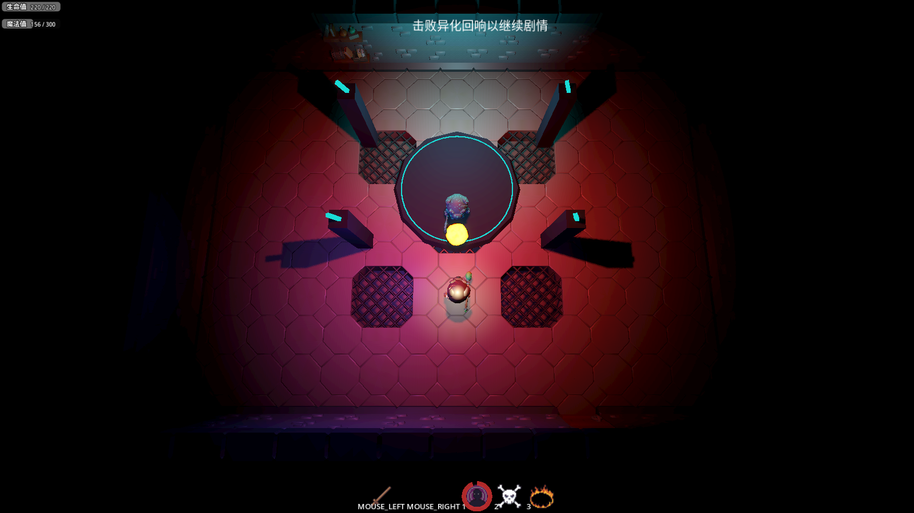
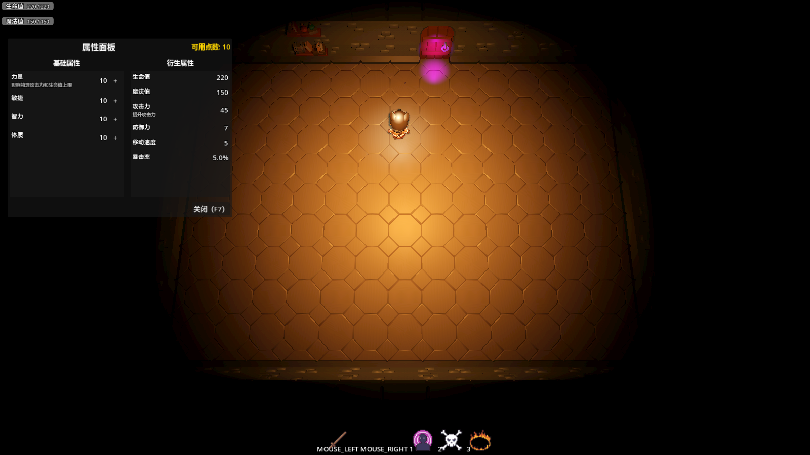
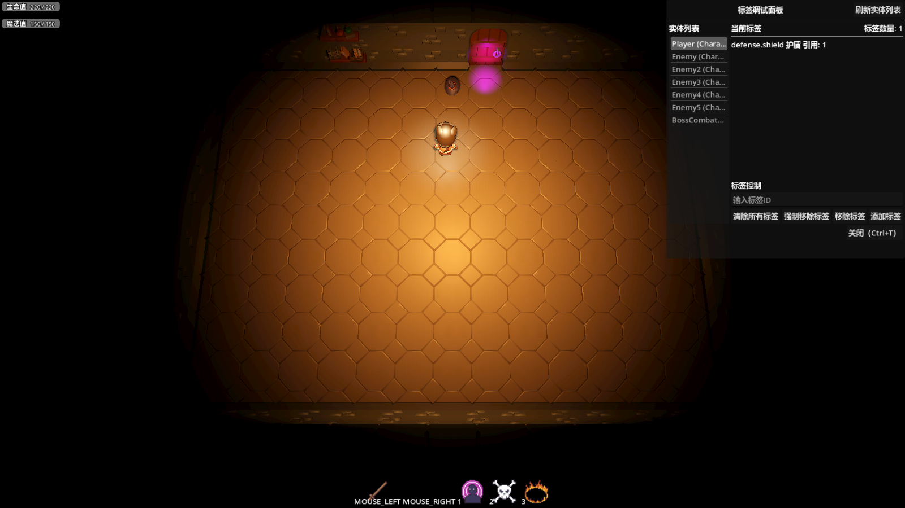

# Godot Gameplay Abilities

[简体中文](README_zh-CN.md)

[](https://github.com/LiGameAcademy/godot_gameplay_abilities/actions/workflows/runtime.yml)
[](https://github.com/LiGameAcademy/godot_gameplay_abilities/stargazers)
[](LICENSE)

A reusable Godot 4 plugin for abilities, attributes, and combat effects. See how the systems work together in the [Godot ARPG Demo](https://github.com/LiGameAcademy/godot_simple_arpg_demo).

> Find more Godot learning resources and support future development via [LiGameAcademy on Patreon](https://www.patreon.com/cw/LiGameAcademy).

[English Discord](https://discord.gg/5KAqAMU8x5) · [itch.io](https://godot-li.itch.io/)

## Features

- Define abilities as resources and grant them to characters through a component. Active abilities support costs, cooldowns, and targeting.
- Track attributes and resources such as health and mana. Apply damage, healing, and attribute modifiers through gameplay effects.
- Apply buffs and debuffs with durations, stacking rules, and periodic effects. Use gameplay tags and filters to control which targets qualify.
- Trigger visual and audio feedback through gameplay cues. The plugin also includes reusable behavior tree nodes.

## ARPG Demo screenshots

**Fireball cast** · The projectile is in flight and the ability is on cooldown.



**Attribute panel (F7)** · View base and derived stats and spend available attribute points.



**Tag debug panel (Ctrl+T)** · Select an entity and inspect its gameplay tags. Here the player has the `defense.shield` tag.



## Installation

From the root of an existing Godot project, add the plugin as a Git submodule.

```bash
git submodule add https://github.com/LiGameAcademy/godot_gameplay_abilities.git addons/godot_gameplay_abilities
```

Open the host project and enable **li_gameplay_abilities** in **Project → Project Settings → Plugins**. The plugin registers the `GameplayAbilitySystem`, `GameplayCueManager`, `AbilityEventBus`, and `TagManager` autoloads.

## Using the plugin

Add a `GameplayAbilityComponent` to the character, define the abilities it can use, and connect the host project's input or AI to ability activation. Configure attribute and status components on actors that need health, mana, buffs, or debuffs. The [ARPG Demo](https://github.com/LiGameAcademy/godot_simple_arpg_demo) shows a working integration with player abilities and enemies.

The [runtime checks](tests/README.md) run with Godot 4.7.2 and Python 3.10+. The [docs directory](docs/) contains design proposals.

## License

[MIT](LICENSE)
