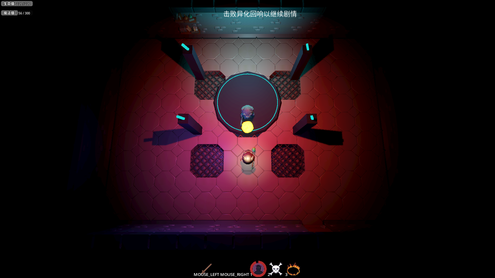
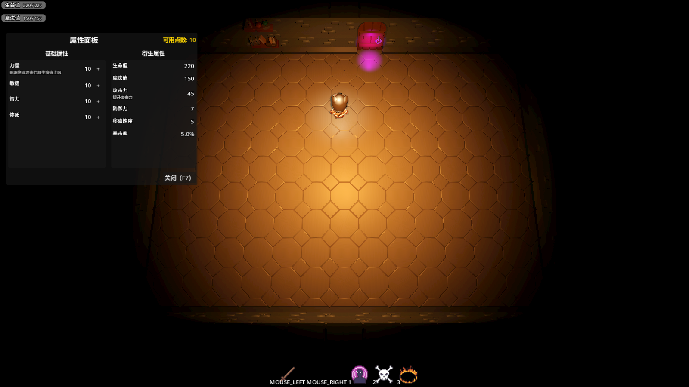
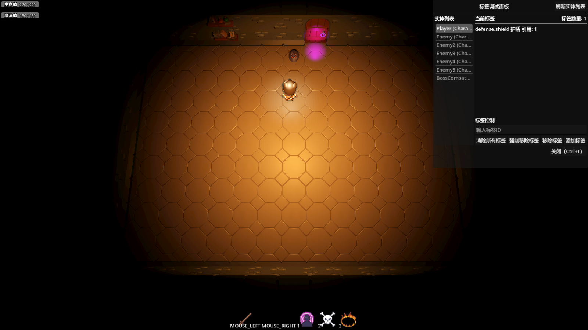

# Godot 通用能力系统

[English](README.md)

[](https://github.com/LiGameAcademy/godot_gameplay_abilities/actions/workflows/runtime.yml)
[](https://github.com/LiGameAcademy/godot_gameplay_abilities/stargazers)
[](LICENSE)

用于构建技能、属性和战斗效果的 Godot 4 插件。可以在 [Godot ARPG 示例工程](https://github.com/LiGameAcademy/godot_simple_arpg_demo)中体验这些功能如何配合。

> 想继续学习 Godot、获取项目学习资源并参与交流，欢迎加入[老李游戏学院知识星球](https://wx.zsxq.com/group/28885154818841)。

[中文 Discord](https://discord.gg/94RZFTRKDP) · [itch.io 主页](https://godot-li.itch.io/) · [B 站主页](https://space.bilibili.com/8618918)

## 功能

- 用 Resource 定义技能，通过组件将技能授予角色。主动技能支持消耗、冷却和目标选择。
- 管理属性及生命值、法力值等资源，通过游戏效果处理伤害、治疗和属性修改。
- 为增益和减益配置持续时间、叠加规则与周期效果，通过玩法标签和过滤器判断目标是否满足条件。
- 使用 Gameplay Cue 触发视觉和音效反馈。插件也提供可复用的行为树节点。

## ARPG 示例实机截图

**释放火球术** · 火球飞向首领，技能栏显示冷却进度。



**属性面板（F7）** · 查看基础属性和衍生属性，也可以分配剩余属性点。



**标签调试面板（Ctrl+T）** · 选择实体后可查看其玩法标签。图中玩家带有 `defense.shield` 标签。



## 安装

在已有 Godot 工程的根目录中，将插件添加为 Git 子模块。

```bash
git submodule add https://github.com/LiGameAcademy/godot_gameplay_abilities.git addons/godot_gameplay_abilities
```

打开宿主工程，在 **项目 → 项目设置 → 插件**中启用 **li_gameplay_abilities**。插件会注册 `GameplayAbilitySystem`、`GameplayCueManager`、`AbilityEventBus` 和 `TagManager` 四个自动加载项。

## 使用

给角色添加 `GameplayAbilityComponent`，配置角色可用的技能，并在宿主工程中将输入或 AI 接到技能激活流程。需要生命值、法力值或增益和减益的角色可以配置对应的属性和状态组件。[ARPG 示例工程](https://github.com/LiGameAcademy/godot_simple_arpg_demo)展示了玩家技能与敌人的实际接入方式。

[运行时检查](tests/README.md)使用 Godot 4.7.2 和 Python 3.10+。[docs 目录](docs/)收录了设计提案。

## 许可证

[MIT](LICENSE)
