# 架构设计方案

## 🎯 设计原则

本插件采用以下核心设计原则：

1. **高内聚、低耦合**：战斗系统的所有逻辑封装在插件内部，对外只暴露必要的API
2. **鸭子类型设计**：组件不继承基类，通过接口方法进行交互，实现终极解耦
3. **组合模式**：`VitalComponent` 管理多个 `Vital` 实例，`GameplayAttributeComponent` 管理多个 `GameplayAttributeSet`
4. **配置驱动**：所有游戏规则通过 Resource 资源定义，支持数据驱动设计
5. **事件驱动**：通过 `CombatEventBus` 实现系统间通讯，解耦逻辑层与表现层

## 🗺️ 架构全景图 (Mermaid)

```mermaid
graph TD
    %% ==========================================
    %% 样式定义
    %% ==========================================
    classDef plugin fill:#2d3436,stroke:#74b9ff,stroke-width:2px,color:#fff;
    classDef business fill:#2d3436,stroke:#55efc4,stroke-width:2px,color:#fff;
    classDef resource fill:#2d3436,stroke:#fdcb6e,stroke-width:2px,stroke-dasharray: 5 5,color:#fff;
    classDef singleton fill:#0984e3,stroke:#fff,stroke-width:2px,color:#fff;

    %% ==========================================
    %% 1. 系统单例层 (System Singletons - Autoloads)
    %% ==========================================
    subgraph Singletons [System Singletons / Autoloads]
        direction TB
        GAS[GameplayAbilitySystem]:::singleton
        EventBus[AbilityEventBus]:::singleton
        DamageCalc[DamageCalculator]:::singleton
    end

    %% ==========================================
    %% 2. 数据资源层 (Data Resources)
    %% ==========================================
    subgraph Resources [Data Resources .tres]
        direction TB
        AbilityRes(GameplayAbility):::resource
        StatusRes(GameplayStatusData):::resource
        EffectRes(GameplayEffect):::resource
        AttrRes(GameplayAttribute):::resource
        AttrSet(GameplayAttributeSet):::resource
        VitalRes(VitalBaseResource):::resource
        DamageInfoRes(DamageInfo):::resource
    end

    %% ==========================================
    %% 3. 插件组件层 (Plugin Components)
    %% ==========================================
    subgraph PluginComponents [Plugin Logic Components]
        direction TB
        AbilityComp[GameplayAbilityComponent]:::plugin
        StatusComp[GameplayStatusComponent]:::plugin
        AttrComp[GameplayAttributeComponent]:::plugin
        VitalComp[VitalComponent]:::plugin
    end
    
    %% ==========================================
    %% 3.5 运行时实例层 (Runtime Instances)
    %% ==========================================
    subgraph Instances [Runtime Instances]
        direction TB
        AttrInstance[GameplayAttributeInstance]:::resource
        StatusInstance[GameplayStatusInstance]:::resource
        HealthVital[HealthVital]:::resource
        ManaVital[ManaVital]:::resource
    end

    %% ==========================================
    %% 4. 业务层 (Business Implementation)
    %% ==========================================
    subgraph BusinessLayer [Business Layer / Entity]
        direction TB
        UnitNode((Unit Entity)):::business
        InputCtrl[Input / AI Controller]:::business
        AnimAdapter[Visual / Animation Adapter]:::business
        AnimPlayer[AnimationPlayer / Tree]:::business
    end

    %% ==========================================
    %% 关系连线
    %% ==========================================

    %% 挂载关系
    UnitNode --> AbilityComp
    UnitNode --> StatusComp
    UnitNode --> AttrComp
    UnitNode --> VitalComp
    UnitNode --> AnimAdapter
    UnitNode --> InputCtrl

    %% 输入流 (Input Flow)
    InputCtrl -- 1. try_activate(context) --> AbilityComp

    %% 技能流程 (Ability Flow)
    AbilityComp -. Read Config .-> AbilityRes
    AbilityComp -- 2. Check Cost/CD --> AttrComp
    AbilityComp -- 3. Emit Signal --> EventBus

    %% 表现流 (Visual Flow)
    EventBus -- 5. Signal: skill_activated --> AnimAdapter
    AnimAdapter -- 6. Play Anim --> AnimPlayer
    AnimPlayer -- 7. Call Method (Impact) --> AnimAdapter
    AnimAdapter -- 8. Apply Effect --> AbilityComp

    %% 效果流程 (Effect Flow)
    AbilityComp -- 9. Apply Effect --> StatusComp
    AbilityComp -- 9. Execute Damage --> VitalComp
    
    %% 状态流程 (Status Flow)
    StatusComp -. Read Config .-> StatusRes
    StatusComp -- Create Instance --> StatusInstance
    StatusInstance -- Apply Modifiers --> AttrInstance
    StatusComp -- Apply Modifiers --> AttrComp

    %% 属性系统流程
    AttrComp -. Read Config .-> AttrSet
    AttrSet -- Create Instance --> AttrInstance
    AttrComp -- Manage Sets --> AttrSet
    AttrInstance -- Value Changed --> AttrComp
    
    %% Vital系统流程
    VitalComp -- Manage Instances --> HealthVital
    VitalComp -- Manage Instances --> ManaVital
    HealthVital -- Listen Changes --> AttrComp
    ManaVital -- Listen Changes --> AttrComp
    VitalComp -- Process Regen --> HealthVital
    VitalComp -- Process Regen --> ManaVital
    
    %% 伤害计算流程
    AbilityComp -- Create DamageInfo --> DamageInfoRes
    AbilityComp -- Calculate Damage --> DamageCalc
    DamageCalc -- Target HealthVital --> HealthVital
    HealthVital -- Apply Damage --> VitalComp
    
    %% 事件系统
    EventBus -- Game Events --> AbilityComp
    EventBus -- Game Events --> StatusComp
    EventBus -- Game Events --> VitalComp

```

-----

## 📝 模块详细说明文档

### 1. 核心单例层 (Core Singletons)

*这些是系统的基础设施，全局唯一，不依赖具体场景。*

* **GameplayAbilitySystem:**
    * **职责:** 游戏技能系统管理器，提供组件查询接口（采用鸭子类型设计）。
    * **功能:** 通过接口方法查询组件，不依赖具体类型。
* **AbilityEventBus:**
    * **职责:** 系统级信号总线，统一管理技能相关事件。
    * **功能:** 解耦逻辑层（Component）与表现层（Adapter），支持统一游戏事件和细粒度信号。
* **DamageCalculator:**
    * **职责:** 伤害计算中心，负责计算最终伤害值。
    * **功能:** 处理类型克制、护甲减免等伤害计算逻辑。

### 2. 插件组件层 (Plugin Components)

*这是插件的核心代码，挂载在 `CharacterBody3D/2D` 上。*

* **GameplayAbilityComponent:**
    * **功能:** 主动技能管理、冷却管理 (Timer)、消耗扣除。
    * **关键接口:** `try_activate_skill(skill_id, context)`。
    * **设计:** 采用鸭子类型设计，不继承基类。
* **GameplayStatusComponent:**
    * **功能:** Buff/Debuff 管理、Tick 周期处理、持续时间管理。
    * **联动:** 当 Buff 生效时，创建 `GameplayStatusInstance`，通过属性修改器影响属性。
    * **设计:** 采用鸭子类型设计，不继承基类。
* **GameplayAttributeComponent:**
    * **功能:** 属性组件，作为属性系统的接口层。
    * **架构:** 管理多个 `GameplayAttributeSet`（属性集），每个属性集管理自己的 `GameplayAttributeInstance`（属性实例）。
    * **计算:** 属性实例计算最终值 = (Base + Additive) \* Multiplier \* (1 + Percentage)。
    * **设计:** 采用组合模式，属性集负责属性依赖关系（如1点力量=10点生命值）。
* **VitalComponent:**
    * **功能:** Vital 组件，管理实体的所有 Vital 实例（生命值、法力值等）。
    * **架构:** 采用组合模式，管理多个 `VitalBaseResource` 实例（如 `HealthVital`、`ManaVital`）。
    * **职责:** 在 `_process` 中处理所有 Vital 的自动恢复，提供统一的访问接口。
    * **设计:** 采用鸭子类型设计，不继承基类。

### 2.5 运行时实例层 (Runtime Instances)

*这些是运行时创建的对象，封装了实体的实际状态。*

* **GameplayAttributeInstance:**
    * **功能:** 属性实例，封装单个属性的运行时状态。
    * **数据:** 包含基础值、修改器列表、缓存的最终值。
    * **计算:** 自动计算最终值，当基础值或修改器变化时触发重新计算。
    * **信号:** 发出 `value_changed` 和 `base_value_changed` 信号。
* **GameplayStatusInstance:**
    * **功能:** 状态实例，封装单个状态（Buff/Debuff）的运行时状态。
    * **数据:** 包含状态数据、剩余时间、层数、施法者等信息。
    * **生命周期:** 管理状态的持续时间、Tick 周期、移除条件。
* **HealthVital / ManaVital:**
    * **功能:** Vital 实例，封装生命值/法力值的运行时状态。
    * **数据:** 包含当前值、最大值（从属性组件获取）、恢复速率。
    * **逻辑:** `HealthVital` 处理伤害、治疗、死亡；`ManaVital` 处理消耗和恢复。
    * **设计:** 继承自 `VitalBaseResource`（Resource 类型），由 `VitalComponent` 管理。

### 3. 数据资源层 (Data Resources)

*这是"配置驱动"的核心，所有的游戏规则都定义在这里。*

* **GameplayAbility:** 技能数据基类，定义技能的 CD、消耗、目标类型、包含的 Effect 列表。
* **GameplayStatusData:** 状态数据（Buff/Debuff），定义持续时间、属性修改器、标签授予/阻挡。
* **GameplayEffect:** 效果基类，定义原子操作（造成伤害、治疗、位移、施加Buff）。
* **GameplayAttribute:** 属性定义，包含属性ID、显示名称、最小值、最大值等元数据。
* **GameplayAttributeSet:** 属性集，组织相关属性（如一级属性集、二级属性集），通过钩子函数实现属性依赖关系。
* **VitalBaseResource:** Vital 基类，定义 Vital 的配置（最大值ID、恢复速率ID等）。
* **DamageInfo:** 伤害信息，包含基础伤害、攻击类型、施法者等信息。

### 4. 业务层 (Business Layer)

*这是您具体开发 ARPG/RTS 项目时编写的代码。*

* **Input / UnitController:**
    * **职责:** 处理玩家输入（按键/鼠标）或 AI 决策。
    * **动作:** 收集上下文 (`Context`)，调用 `AbilityComponent.try_activate()`。
* **VisualAdapter (Animation Adapter):**
    * **职责:** 监听 `AbilityEventBus` 的信号。
    * **动作:** 将信号翻译为 `AnimationPlayer.play()` 或 `AnimationTree.travel()`。
    * **回调:** 接收动画的关键帧事件，回传给组件层触发伤害。

-----

### 🔄 核心数据流 (The Data Pipeline)

为了让您理清它们是如何协作的，这里演示一个**"火球术"**的完整生命周期：

1.  **Input:** 玩家按下 Q 键。`PlayerController` 收集鼠标位置，构建 `Context`，调用 `AbilityComponent.try_activate("fireball")`。
2.  **Check:** `AbilityComponent` 检查技能配置，询问 `AttributeComponent`："蓝够吗？" -\> 通过 `ManaVital.try_spend_mana()` 检查。
3.  **Cost & CD:** 通过 `ManaVital.try_spend_mana()` 扣除蓝量，启动 CD 计时器。
4.  **Signal:** `AbilityComponent` 通过 `AbilityEventBus` 发出统一游戏事件 `ability_activated`。
5.  **Visual:** `VisualAdapter` 监听 `AbilityEventBus` 事件，播放 "Cast\_Fireball" 动画。
6.  **Impact:** 动画播到 0.5秒，触发帧事件。`VisualAdapter` 调用 `AbilityComponent.apply_skill_effect()`。
7.  **Effect:** `AbilityComponent` 读取 `GameplayAbility` 里的 `GameplayEffect`，直接调用 `effect.apply()` 执行效果。
      * **Logic:** 生成投射物逻辑对象。
      * **Event:** 通过 `AbilityEventBus` 触发特效事件。
8.  **Hit:** 投射物命中敌人。
      * **DamageInfo:** 创建 `DamageInfo` 对象，包含基础伤害、攻击类型等信息。
      * **Damage Calculation:** 通过 `DamageCalculator.calculate_final_damage()` 计算最终伤害。
          * 获取目标 `HealthVital` 的护甲类型和护甲值。
          * 计算类型克制倍率。
          * 计算护甲减伤。
      * **Apply Damage:** 调用目标 `HealthVital.apply_damage()` 应用伤害。
          * `HealthVital` 检查是否存活、是否无敌。
          * 触发 `AbilityEventBus` 的 `damage_received` 和 `damage_dealt` 事件。
          * 更新当前生命值，检查死亡。
      * **Status:** 直接调用效果的 `apply()` 方法，给敌人挂上 "Burning" Buff。
          * `GameplayStatusComponent` 创建 `GameplayStatusInstance`。
          * `GameplayStatusInstance` 通过 `GameplayAttributeModifier` 修改属性。
          * 属性修改器应用到 `GameplayAttributeInstance`。
          * `GameplayAttributeInstance` 重新计算最终值，触发变化信号。
      * **Attribute Dependency:** 如果属性变化影响派生属性（如力量变化影响最大生命值）。
          * `GameplayAttributeSet` 的 `_on_attribute_dependency_changed()` 钩子函数被调用。
          * 更新派生属性（如最大生命值）。
          * `HealthVital` 监听到最大生命值变化，自动调整当前生命值。
